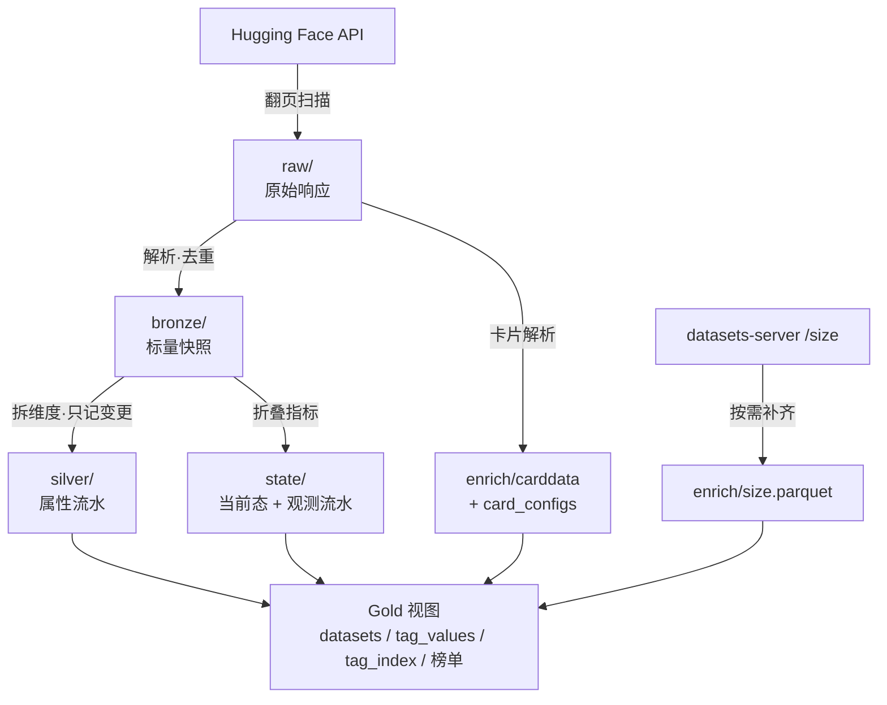

# data 目录说明

> 本文件由 `uv run hf-data-crawl docs` 生成于 2026-11-09 19:23，**请勿手工编辑**。
> 表结构与行数由代码和实际文件算出；字段含义维护在 `src/hf_data_crawl/fielddocs.py`。
> 改完代码后重新生成即可，`tests/test_docs.py` 会在忘记生成时报错。

## 一、数据是怎么流过来的



**Raw 是唯一不可重算的一层**：其余各层删掉都能从它重新推出来，
所以 `build` 可以断网重跑，而 `raw/` 一旦丢失就真的没有了。

## 二、目录一览

```
data/
├── raw/dt=YYYY-MM-DD/          # 原始响应：热区原样，7 天后压缩移出（当前 5,168 个文件 · 1.2 GB）
├── cold/raw/                   # 冷区基线（跨天去重）+ manifest.json
├── backup/raw/dt=YYYY-MM-DD/   # 归档/压缩移出的原分块，人工确认后清理
├── bronze/dt=YYYY-MM-DD/       # 标量快照，只保留最新一天（当前 1 个文件 · 288.6 MB）
├── silver/dt=YYYY-MM-DD/       # 属性变更流水（当前 6 个文件 · 281.7 MB）
├── state/                      # 当前态与观测流水（当前 12 个文件 · 185.4 MB）
├── enrich/                     # 卡片与规模（当前 4 个文件 · 155.2 MB）
├── meta/                       # 重建中断时留存的状态快照（当前 空）
├── reports/                    # 对账清单与榜单页（当前 5 个文件 · 41.1 MB）
├── runs/                       # 每轮运行摘要（当前 99 个文件 · 51.2 KB）
├── exports/                    # 宽表导出（可重建，当前 1 个文件 · 198.7 MB）
└── logs/                       # 计划任务日志（按轮命名，最近 200 个）
```

**`dt=YYYY-MM-DD/` 是分区键，不是「按日期分的文件夹」**：`dt` 是列名、日期是它的值，
DuckDB / Spark / Athena 都能零配置把它当列读出来；表内另有 `snapshot_date` 列，
所以查询不依赖路径也能过滤到某一天。目录里多数只有一个文件（一张表每天写一份），
看着像是多套了一层；`raw/` 同一天有几十个分块，那里才看得出分区的必要。
两者都不改：文件名带日期只是人眼可读的约定，机器要正则解析才认得，换工具时还要重配。

## 三、各张表

### `bronze/dt={dt}/bronze.parquet`

- 逻辑名：`bronze`
- 来源：由 `raw/` 派生，可随时重建
- 分区：按 `snapshot_date` 分目录，`dt=` 后即日期
- 现状：1 个分区 · 1,123,620 行 · 288.6 MB

| 字段 | 类型 | 含义 |
| --- | --- | --- |
| `id` | 字符串 | 数据集标识，形如 `作者/名称`，全库唯一 |
| `url` | 字符串 | 数据集页面地址，形如 `https://huggingface.co/datasets/作者/名称`；由 `id` 拼出，可直接点开 |
| `author` | 字符串 | 拥有者账号（`id` 的前半段） |
| `sha` | 字符串 | 主分支最新提交哈希；仓库内容一变它就变 |
| `created_at` | 日期时间(UTC) | 仓库创建时刻（UTC，带时区的时间类型，可直接做时间运算） |
| `last_modified` | 日期时间(UTC) | 最后一次提交的时刻（UTC）；增量扫描按它排序 |
| `downloads` | 整数 | **近 30 天**下载量。不是累计值，也不是当日增量 |
| `downloads_all_time` | 整数 | 历史累计下载量，只增不减 |
| `likes` | 整数 | 点赞数 |
| `trending_score` | 浮点 | HF 计算的趋势分，可为空；它随时间漂移，**不能用来排序翻页** |
| `gated` | 字符串 | 访问门槛：`false` 公开、`manual` 需人工审批、`auto` 自动授权 |
| `private` | 布尔 | 是否私有。私有库对外不可见，但公开索引里可能仍留一条记录 |
| `disabled` | 布尔 | 是否被平台禁用 |
| `main_size` | 整数 | 主分支的仓库字节数（含 LFS 指针指向的实际大小） |
| `xet_enabled` | 布尔 | 是否使用 Xet 存储后端 |
| `resource_group` | 字符串 | 所属资源组；原值是复合结构，按 JSON 文本存储。**列表接口从不返回此字段**（实测请求了也拿不到），故整列为空 |
| `tags` | 字符串数组 | 原始标签全集，形如 `license:mit`、`language:en`；维度列都由它拆出 |
| `description` | 字符串 | 仓库简介（作者填写，非卡片正文） |
| `raw` | 字符串 | 该条记录对应的原始 JSON 整行——其余各层都能重算，只有它能回溯上游 |
| `page_file` | 字符串 | 来源分块文件名，用于把一行追回到具体的 raw 文件 |
| `snapshot_date` | 日期 | 快照日期，也是分区键——同一条记录落在哪个 `dt=` 目录 |

### `silver/dt={dt}/silver.parquet`

- 逻辑名：`silver`
- 来源：由 `raw/` 派生，可随时重建
- 分区：按 `snapshot_date` 分目录，`dt=` 后即日期
- 现状：6 个分区 · 2,264,514 行 · 281.7 MB

| 字段 | 类型 | 含义 |
| --- | --- | --- |
| `id` | 字符串 | 数据集标识，形如 `作者/名称`，全库唯一 |
| `url` | 字符串 | 数据集页面地址，形如 `https://huggingface.co/datasets/作者/名称`；由 `id` 拼出，可直接点开 |
| `author` | 字符串 | 拥有者账号（`id` 的前半段） |
| `sha` | 字符串 | 主分支最新提交哈希；仓库内容一变它就变 |
| `created_at` | 日期时间(UTC) | 仓库创建时刻（UTC，带时区的时间类型，可直接做时间运算） |
| `last_modified` | 日期时间(UTC) | 最后一次提交的时刻（UTC）；增量扫描按它排序 |
| `trending_score` | 浮点 | HF 计算的趋势分，可为空；它随时间漂移，**不能用来排序翻页** |
| `gated` | 字符串 | 访问门槛：`false` 公开、`manual` 需人工审批、`auto` 自动授权 |
| `private` | 布尔 | 是否私有。私有库对外不可见，但公开索引里可能仍留一条记录 |
| `disabled` | 布尔 | 是否被平台禁用 |
| `main_size` | 整数 | 主分支的仓库字节数（含 LFS 指针指向的实际大小） |
| `xet_enabled` | 布尔 | 是否使用 Xet 存储后端 |
| `resource_group` | 字符串 | 所属资源组；原值是复合结构，按 JSON 文本存储。**列表接口从不返回此字段**（实测请求了也拿不到），故整列为空 |
| `description` | 字符串 | 仓库简介（作者填写，非卡片正文） |
| `tags` | 字符串数组 | 原始标签全集，形如 `license:mit`、`language:en`；维度列都由它拆出 |
| `task_categories` | 字符串数组 | 任务大类（`text-classification`、`image-segmentation` 等） |
| `task_ids` | 字符串数组 | 具体任务标识，比大类更细 |
| `languages` | 字符串数组 | 语言代码，已把三字码折成两字码（`eng`→`en`）；无 ISO 639-1 码的语言（`yue`、`ceb`）保持原样 |
| `size_categories` | 字符串数组 | 规模档位（`n<1K`、`1K<n<10K` … `n>1T`） |
| `licenses` | 字符串数组 | 许可证（`mit`、`apache-2.0`、`cc-by-4.0` 等） |
| `libraries` | 字符串数组 | 适配的框架库（`datasets`、`pandas`、`polars` …） |
| `modalities` | 字符串数组 | 模态（`text`/`image`/`audio`/`video`/`3d`/`tabular` 等；无前缀的 `multimodal` 也会并入，属本仓库扩展取值） |
| `formats` | 字符串数组 | 数据文件格式（`parquet`、`csv`、`json`、`arrow` …） |
| `regions` | 字符串数组 | 数据覆盖的地区 |
| `multilinguality` | 字符串数组 | 多语言性标记（单语 / 多语） |
| `source_datasets` | 字符串数组 | 该数据集派生自哪些上游数据集 |
| `annotations_creators` | 字符串数组 | 标注者类型（专家、众包、机器生成等） |
| `language_creators` | 字符串数组 | 语料来源（原始采集、翻译、机器生成等） |
| `arxiv_ids` | 字符串数组 | 关联的 arXiv 论文编号 |
| `dois` | 字符串数组 | 关联的 DOI |
| `plain_tags` | 字符串数组 | 不带前缀的标签（旧式 `text`/`image` 标记都在这里） |
| `snapshot_date` | 日期 | 该行**生效**的日期；同 id 取最新一行即为当前属性 |

### `state/current.parquet`

- 逻辑名：`current`
- 来源：运行态，由派生过程维护
- 分区：单文件，不分区
- 现状：1,126,457 行 · 70.0 MB

| 字段 | 类型 | 含义 |
| --- | --- | --- |
| `id` | 字符串 | 数据集标识，形如 `作者/名称`，全库唯一 |
| `url` | 字符串 | 数据集页面地址，形如 `https://huggingface.co/datasets/作者/名称`；由 `id` 拼出，可直接点开 |
| `author` | 字符串 | 拥有者账号（`id` 的前半段） |
| `sha` | 字符串 | 主分支最新提交哈希；仓库内容一变它就变 |
| `created_at` | 日期时间(UTC) | 仓库创建时刻（UTC，带时区的时间类型，可直接做时间运算） |
| `last_modified` | 日期时间(UTC) | 最后一次提交的时刻（UTC）；增量扫描按它排序 |
| `downloads` | 整数 | **近 30 天**下载量。不是累计值，也不是当日增量 |
| `downloads_all_time` | 整数 | 历史累计下载量，只增不减 |
| `likes` | 整数 | 点赞数 |
| `trending_score` | 浮点 | HF 计算的趋势分，可为空；它随时间漂移，**不能用来排序翻页** |
| `gated` | 字符串 | 访问门槛：`false` 公开、`manual` 需人工审批、`auto` 自动授权 |
| `private` | 布尔 | 是否私有。私有库对外不可见，但公开索引里可能仍留一条记录 |
| `disabled` | 布尔 | 是否被平台禁用 |
| `main_size` | 整数 | 主分支的仓库字节数（含 LFS 指针指向的实际大小） |
| `xet_enabled` | 布尔 | 是否使用 Xet 存储后端 |
| `resource_group` | 字符串 | 所属资源组；原值是复合结构，按 JSON 文本存储。**列表接口从不返回此字段**（实测请求了也拿不到），故整列为空 |
| `first_seen_at` | 日期 | 首次出现在库里的日期 |
| `last_seen_at` | 日期 | 最后一次被扫描到的日期；停更不等于下架 |
| `status` | 字符串 | `active` 在架 / `disappeared` 已删除 / `restricted` 转私有 / `renamed` 已改名 |

### `state/observations/dt={dt}/obs.parquet`

- 逻辑名：`observations`
- 来源：运行态，由派生过程维护
- 分区：按 `snapshot_date` 分目录，`dt=` 后即日期
- 现状：6 个分区 · 3,755,437 行 · 115.3 MB

| 字段 | 类型 | 含义 |
| --- | --- | --- |
| `id` | 字符串 | 数据集标识，形如 `作者/名称`，全库唯一 |
| `url` | 字符串 | 数据集页面地址，形如 `https://huggingface.co/datasets/作者/名称`；由 `id` 拼出，可直接点开 |
| `snapshot_date` | 日期 | 这次观测发生的日期 |
| `downloads` | 整数 | **近 30 天**下载量。不是累计值，也不是当日增量 |
| `downloads_all_time` | 整数 | 历史累计下载量，只增不减 |
| `likes` | 整数 | 点赞数 |

### `enrich/carddata.parquet`

- 逻辑名：`carddata`
- 来源：由 `raw/` 派生，可随时重建
- 分区：单文件，不分区
- 现状：770,482 行 · 41.4 MB

| 字段 | 类型 | 含义 |
| --- | --- | --- |
| `id` | 字符串 | 数据集标识，形如 `作者/名称`，全库唯一 |
| `url` | 字符串 | 数据集页面地址，形如 `https://huggingface.co/datasets/作者/名称`；由 `id` 拼出，可直接点开 |
| `snapshot_date` | 日期 | 快照日期，也是分区键——同一条记录落在哪个 `dt=` 目录 |
| `source_sha` | 字符串 | 抓这张卡时该库的 commit sha。拿它与 `sha`（仓库当前版本）对照，就能判断卡片是否落后——`snapshot_date` 只说什么时候抓的，不说内容对应哪一版。加列之前抓的行为空，属预期 |
| `pretty_name` | 字符串 | 卡片里的展示名（可能与 `作者/名称` 完全不同） |
| `paperswithcode_id` | 字符串 | Papers with Code 上的条目 id |
| `arxiv` | 字符串 | 卡片声明的 arXiv 编号 |
| `license_name` | 字符串 | 卡片声明的许可证名称 |
| `license_link` | 字符串 | 许可证全文链接 |
| `citation` | 字符串 | 作者给出的引用格式（BibTeX 或纯文本） |
| `card_description` | 字符串 | **卡片正文**的开头摘要，与 `description` 字段不是一回事 |
| `card_tags` | 字符串数组 | 卡片 YAML 里声明的标签（作者口径，非平台规范化） |
| `card_task_categories` | 字符串数组 | 卡片声明的任务大类 |
| `card_languages` | 字符串数组 | 卡片声明的语言 |
| `card_size_categories` | 字符串数组 | 卡片声明的规模档 |
| `card_multilinguality` | 字符串 | 卡片声明的多语言性 |
| `card_annotations_creators` | 字符串数组 | 卡片声明的标注者类型 |
| `card_language_creators` | 字符串数组 | 卡片声明的语料来源 |
| `card_source_datasets` | 字符串数组 | 卡片声明的上游数据集 |
| `card_homepage` | 字符串 | 项目主页 |
| `card_config_count` | 整数 | 卡片里列出的 config 个数 |
| `card_num_rows` | 整数 | **作者声明**的总行数（跨 config 累加），未必准 |
| `card_dataset_bytes` | 整数 | 作者声明的数据体积 |
| `card_download_bytes` | 整数 | 作者声明的下载体积（压缩后） |

### `enrich/card_configs.parquet`

- 逻辑名：`card_configs`
- 来源：由 `raw/` 派生，可随时重建
- 分区：单文件，不分区
- 现状：1,846,706 行 · 37.2 MB

| 字段 | 类型 | 含义 |
| --- | --- | --- |
| `id` | 字符串 | 数据集标识，形如 `作者/名称`，全库唯一 |
| `url` | 字符串 | 数据集页面地址，形如 `https://huggingface.co/datasets/作者/名称`；由 `id` 拼出，可直接点开 |
| `snapshot_date` | 日期 | 快照日期，也是分区键——同一条记录落在哪个 `dt=` 目录 |
| `config_name` | 字符串 | 配置名（一个数据集可以有多个 config，如不同语言子集） |
| `split` | 字符串 | 切分名（`train`、`test`、`validation`） |
| `num_bytes` | 整数 | 该 split 的原始字节数 |
| `num_examples` | 整数 | 该 split 的行数 |
| `dataset_size` | 整数 | 生成 arrow 后的内存占用（卡片口径） |
| `download_size` | 整数 | 下载体积（卡片口径） |
| `features` | 字符串 | 列名与数据类型的 JSON 描述——整条管线里唯一能回答「有哪些列」的来源 |
| `data_files` | 字符串 | 该 split 由哪些文件构成（JSON 数组，可能是通配符） |

### `enrich/size.parquet`

- 逻辑名：`size`
- 来源：来自外部接口，**删掉就要重抓**
- 分区：单文件，不分区
- 现状：1,122,650 行 · 76.6 MB

| 字段 | 类型 | 含义 |
| --- | --- | --- |
| `id` | 字符串 | 数据集标识，形如 `作者/名称`，全库唯一 |
| `url` | 字符串 | 数据集页面地址，形如 `https://huggingface.co/datasets/作者/名称`；由 `id` 拼出，可直接点开 |
| `snapshot_date` | 日期 | 最近一次成功补抓的日期 |
| `status` | 字符串 | `ok` 拿到数据 / `unavailable` 上游没有这份数据 / `error` 临时失败 |
| `num_rows` | 整数 | datasets-server **实测**行数，与 `card_num_rows` 是两个口径 |
| `estimated_num_rows` | 整数 | 上游给出的估算行数（未做精确统计时才有） |
| `num_bytes_original` | 整数 | 原始文件字节数 |
| `num_bytes_parquet` | 整数 | 转成 parquet 后的字节数 |
| `num_bytes_memory` | 整数 | 载入内存后的估算占用 |
| `config_count` | 整数 | 上游报告的 config 个数 |
| `num_columns_max` | 整数 | 各 config 中列数的最大值 |
| `configs` | 字符串 | 各 config 的明细（JSON 文本） |

### `enrich/files.parquet`

- 逻辑名：`files`
- 来源：来自外部接口，**删掉就要重抓**
- 分区：单文件，不分区
- 现状：1,000 行 · 56.8 KB

| 字段 | 类型 | 含义 |
| --- | --- | --- |
| `id` | 字符串 | 数据集标识，形如 `作者/名称`，全库唯一 |
| `url` | 字符串 | 数据集页面地址，形如 `https://huggingface.co/datasets/作者/名称`；由 `id` 拼出，可直接点开 |
| `snapshot_date` | 日期 | 最近一次补抓文件清单的日期 |
| `status` | 字符串 | `ok` 拿到文件树 / `unavailable` 仓库不可访问 / `error` 临时失败 |
| `file_count` | 整数 | 本页 tree 里 type=file 的条目数；truncated 时只是下限，不是全库真值 |
| `total_bytes` | 整数 | 本页文件 size 之和；全部缺失时留空，不拿 0 冒充 |
| `formats` | 字符串 | 本页扩展名计数（JSON 文本）；无扩展名的归入 (none) |
| `has_readme` | 布尔 | 本页是否存在以 README 开头的文件 |
| `truncated` | 布尔 | 是否还有未取的下一页；为 true 时上面四项都只是下限 |

## 四、不属于表的东西

### raw 分块

文件名形如 `<类别>-<来源>-<页号>-<内容摘要>.json.gz`；旧格式与旧归档分片省略 `<来源>`。
来源由 `ScanSpec` 的 mode + sort 派生，日增量、顶部刷新、卡片补齐各有独立页码空间。
归档后变为 `<类别>-<来源>-archive-<序号>-<摘要>.json.gz`，分片内仍按原分段保留排序键。
`cold/raw/baseline-*.json.gz` 是跨天去重的冷区基线，与热区分块一起回放。
摘要由内容算出：同一页同一内容重写为同一个文件（幂等），内容变了则另存（绝不覆盖丢数据）。
排序依据是 payload 里的 `written_at`，**不是文件名、也不是文件修改时间**。

| 前缀 | 批次 | 派生去向 |
| --- | --- | --- |
| `part-*.json.gz` | 日增量扫描的分块（按 `lastModified` 倒序） | bronze → silver → state |
| `top-*.json.gz` | 顶部池刷新的分块（按 `downloads` 倒序） | 同上，让增速榜每天有新读数 |
| `card-*.json.gz` | 卡片补齐的分块（带 `cardData`） | carddata · card_configs |

### 其他

| 路径 | 作用 | 生命周期 |
| --- | --- | --- |
| `logs/` | 计划任务的输出日志，**按轮命名**（`时间戳-任务名.log`），与 `runs/` 同键不同扩展名，自动保留最近 `LOG_KEEP` 个 | 不参与任何派生 |
| `runs/` | 每轮运行摘要，成功与失败都写（保留最近 `RUNS_KEEP` 条）；`status` 与 `reason` 由命令结局推出 | 只读，供对比两轮退化 |
| `reports/` | 对账差异清单（`reconcile-YYYY-MM-DD.csv`，保留最近 `REPORT_KEEP` 份）与榜单页 `dashboard.html` | 只读，供人工核对 |
| `ALERT.txt` | 体检发现异常时写入，正常时不存在 | `doctor` 写 |
| `state/reconcile-seen.csv` | 对账会话的已见集合，续跑时靠它避免把前半段误判下架 | 对账完成后删除 |
| `state/*-checkpoint.json` | 扫描游标，记录下一页从哪开始 | 走到末页后清空 |
| `state/lineage.json` | 派生戳记：逐日记下当日 Raw 分块指纹、派生时刻与三层行数；`doctor` 据此判断「Raw 改过、派生有没有跟上」 | **可重建**：删掉后跑 `build --stale` 重放一遍即恢复 |
| `state/health-history.jsonl` | 体检流水：每次 `doctor` 一行（时间、问题条数、问题原文），据它回答「断日从哪天开始」；保留最近 `HEALTH_KEEP` 次 | **可重建**：删掉只是丢历史，不影响任何数据 |
| `exports/` | 宽表导出：`gold.datasets` 视图的单文件 parquet，供分析工具直接打开；每日 04:50 自动重导出（物化投影不会跟着派生自己更新） | **可重建**：不参与派生，删掉后重跑 `export-wide` |

## 五、几个容易误解的地方

1. **`downloads` 是近 30 天，不是累计**。累计值在 `downloads_all_time`，只增不减。
2. **`card_num_rows` 与 `num_rows` 是两个口径**：前者是作者在卡片里声明的，后者是
   datasets-server 实测的。两个都留着，就是为了让它们能对不上时被看见。
3. **`silver` 是属性流水，不是每日快照**。一个 id 只在属性变化时追加一行，
   所以它的行数会少于 `bronze` 的累计行数；指标历史在 `state/observations`。
4. **`bronze` 只保留最新一天**。历史快照没有保留价值——它可由 `raw` 重算。
5. **`status` 的 `restricted` 不是删除**。它表示数据集转为私有，数据还在，
   只是不再公开。真正删除的 `disappeared` 在全站 111 万条里曾长期为 0。
6. **`main_size` 是仓库字节，不等于数据本身的体积**。仓库含历史版本与 LFS 开销。
7. **每张表都带 `url`，虽然它是算出来的**。HF 接口不返回地址——原始响应里只有
   一个 `_id`，那是 MongoDB 内部主键，不是网页地址。地址由 `id` 唯一确定，所以
   每张表都存一列：翻表时拿到 id 就能点开，不必先想起「要 join 哪个视图」。
   这是一处有意的冗余，实测 111.7 万行只多 12.4 MB。
8. **有几个「看着像结构、实际存成文本」的列**：`resource_group`、`features`、
   `data_files`、`configs`。它们的内容是嵌套 JSON，但形态不固定——`features` 的键
   随数据集而变，写成固定 struct 必然有一半字段落空。存文本是刻意的选择；
   需要拆开时用 DuckDB 的 `json_extract` 或 polars 的 `str.json_decode`，
   不必为了少数查询把结构硬编码进 schema。
9. **`resource_group` 整列为空，不是抓漏了**。字段名在接口的 expand 白名单里，
   我们也确实在请求里带了它，但列表接口收到请求也不返回（实测 2 万条里连键都不存在）。
   它只在单库详情里出现，逐库请求 112 万次不现实——所以这一列保留但为空，
   等上游哪天在列表里开放。
10. **`current` 只有 19 列不是抓漏了**：语义字段在 `silver` / `carddata` / `size`，
    由 `gold.datasets` 视图拼成宽表；需要单文件宽表见第八节。
11. **白名单合法不等于接口会返回**：`siblings` / `resourceGroup` 请求了也拿不到，
    实测数据与替代方案见第九节。
12. **观测不全是 `bronze` 推出来的**。当日观测 = 当日 `bronze` ∪ 补抓批次里
    **该日扫描没见过的 id**。补抓批次指 `enrich` 写下的 `card-*` 分块：它不进
    `bronze`（否则行数随补抓节奏膨胀），但仍属当日真实观测，故按 id 补空位。
    后果有二：同一 id 若两边都有，指标以扫描批次为准；某一日补抓覆盖越广，
    该日观测行数就越多——11-07 因补抓覆盖近全库，观测由 20.5 万补到 78.2 万，
    这不是虚增，原先那 20.5 万才是只扫了头部。
    **`silver` 用的是同一份当日帧**（`bronze.day_frame`）：补位若只做在状态层，
    这批库会有当前态、有观测，却没有属性行——2026-11-08 体检实测 203 个，
    `datasets` 宽视图里它们的 tags / description 整片为 null。
13. **`runs/` 与 `logs/` 不是重复**：前者是机读台账（JSON，doctor 与两轮对比都靠它，
    保留最近 500 条），后者是人读现场（纯文本，带进度与逐条 `[ok]` / `[!]`）。
    两者同键不同扩展名：`20261108T031000-collect.json` 与同名 `.log` 是同一次运行。
    体检结论不进 `runs/`——`doctor` 退出码 1 是「有告警」而非「命令失败」，
    记成 failed 会污染「近 7 天无失败运行」那条判据；它的结论看 `ALERT.txt`
    （覆盖式，只存最新一次）、流水 `state/health-history.jsonl`（一行一次，
    据它追「断日从哪天开始」）与 `logs/` 里那轮的日志。
14. **`size` / `files` / `carddata` 里同一张表可能有多个 `snapshot_date`**：
    它们是按 id 覆盖的单文件表，这一列记的是「该行最后一次成功抓取的日期」。
    补抓只覆盖按下载量排的头部，长尾行自然停在更早的日期——这不是陈旧，
    它表达的正是「这个值是哪天取得的」。看全表口径取 `max(snapshot_date)`，
    判断单行可信度就用它自己那一列。

## 六、HF 页面上的数字，在表里是哪个字段

数据集页面上那两张卡片（行数、文件大小）不是同一个来源，对应到表里也是不同字段。

| 页面显示 | 表字段 | 覆盖 | 说明 |
| --- | --- | --- | --- |
| Number of rows | `size.num_rows` | 74.3% | datasets-server 实测行数 |
| Total file size | `current.main_size` | 100.0% | **仓库字节**，含 LFS 与历史版本 |
| Estimated rows（预估行数） | `size.estimated_num_rows` | 0.7% | 上游按体积估算，精度差 |
| Columns | `size.num_columns_max` | 66.8% | 各 config 中列数的最大值 |

**两处必须留意的差异**：

1. `Total file size` 取的是 `main_size`（仓库字节），**不是** `size.num_bytes_original`。
   两者在 58% 的数据集上相等，但四分之一以上差 4 倍——多 config 的大数据集尤其明显
   （实测 `permutans/wdc-common-crawl-embedded-jsonld`：页面 3.79 TB = `main_size`，
   而 `num_bytes_original` 只有 1.48 TB）。要「和页面对得上」就用 `main_size`。
2. `estimated_num_rows` 只在数据集太大、上游放弃精确统计时才出现，且**极不准**：
   实测有 1.64 亿行被估成 289 亿（差 175 倍）的例子。它只适合做「量级判断」，
   需要准确行数时看 `num_rows`，宁可空着也不要拿估算值冒充。

页面上的卡片只在有数据时才显示——我们抓不到，通常意味着上游也没算出来。

## 七、各表行数为什么不一样

`current` 的 1,126,457 行是全站数据集总数。看到别的表「只有几万或十几万」时，
先看它是**什么粒度**——不是缺数据，是每行代表的不是同一个东西：

| 表 | 行数 | 粒度 | 与 `current` 的关系 |
| --- | --- | --- | --- |
| `current` | 1,126,457 | 一个数据集一行 | **基准**——全站数据集总数 |
| `silver` | 2,264,514 | 一次属性变更一行 | **多对一**：改过几次就有几行，比基准多 |
| `observations` | 3,755,437 | 一次指标变化一行 | **多对一**：指标变过才追加 |
| `bronze` | 1,123,620 | 某天扫到的一条记录 | **子集**：只留最新一天，历史由 `raw` 重算 |
| `carddata` | 770,482 | 一个数据集一行 | **子集**：按下载量取头部补齐；长尾多数没有卡片 |
| `card_configs` | 1,846,706 | 一个 config/split 一行 | **展开**：卡片里的 config 逐条拆开 |
| `size` | 1,122,650 | 一个数据集一行 | **全量**：每库一条，其中约七成有实测行数 |
| `files` | 1,000 | 一个数据集一行 | **子集**：按下载量取头部补文件树，长尾没有 |

归纳起来只有三种：**一对一**（`current`，唯一全量）、**多对一**（流水，比基准多）、
**子集**（按天或按需补齐，比基准少）。想知道某个数据集的全部信息，
以 `current` 为主表 `LEFT JOIN` 其余各表即可——所有表的 id 都能在 `current` 里找到；
不想自己拼 join 时，直接导出第八节那份宽表即可。

## 八、宽表导出（可重建，不是事实源）

`hf-data-crawl export-wide` 按**默认交付字段契约**把 `gold.datasets` 视图
裁成 31 列写成一份 parquet，默认落在 `data/exports/datasets.parquet`，
行数与 `current` 相同。视图本身仍保留全部列供内部查询，导出物只留「与数据集
有关、有用且必要」的画像字段：标识、描述、热度、许可、语言、模态、任务、
数据类型、规模、大小。

这份文件同时是**默认参考交付底库**：数据集筛选需求若未写 `output.columns`，
就按同一份契约投影。契约在 `fields.py`（含逐列中文定义与 `CONTRACT_VERSION`），
导出物、查询编译、体检勾稽三处共用，不在文档里手抄第二份列清单。

契约 v5 共 31 列，含 `tags` / `plain_tags`
（API 原样标签与拆出的自定义标签，即详情页 `Tags` 那一行）。少数数据集只在
卡片 YAML 里声明、没同步进 `tags`，默认投影用 `card_*` 同义列兜底；
`gold.datasets` 视图语义不改，内部仍可分列追溯。交付 README 附「页面标签 ↔
库列名 ↔ 值的显示形式」对照表，CSV 把语言 / 任务 / 规模的机器码展平成页面
形式，parquet 与 SQL 结果保留机器码以便筛算。

v5 起标签列回到 LIST 原值，与 `gold.datasets` 视图完全同构：要按单个标签
精确筛选，导出物本身就能 `list_contains`。v3 曾把这类列压成 `;` 字符串，
只是为了绕开自家预览器取列名的缺陷（已随上游 PR 修好），折衷手段随之撤销。

契约 v5 起默认面扩充到 31 列：新增展示名、
多语言性、arXiv 论文号、上游数据集与细分任务。**地区 `regions` 刻意不进默认面**
——实测 100% 有值，但 99.94% 是 HF 自动推断的 `us`，等于每行填个常量。

### 扩展字段（不进默认面，按需取用）

以下字段一直都在 `gold.datasets` 视图里，只是**不进默认交付面**：低覆盖列塞回默认面会让九成行重新变空。需要时在 spec 里写 `output.columns: [id, <列名>]` 即可投列（列名既认词条也认视图列名）。空值表示作者未声明，不代表没有。覆盖档基于 2026-11-08 全库 112 万行实测，精确值以当期 `doctor` 为准。

| 字段 | 定义 | 覆盖档 |
| --- | --- | --- |
| `regions` | 数据覆盖地区标签 | 全库有值但 99.94% 是 HF 自动推断的 us，无区分度 |
| `dois` | 关联的 DOI 编号 | 低（<1%） |
| `paperswithcode_id` | Papers with Code 条目 id | 极低（<0.2%） |
| `arxiv` | 卡片里声明的 arXiv 编号 | 极低（<0.1%） |
| `citation` | 作者给出的引用格式（BibTeX / 纯文本） | 极低（<0.5%，长文本） |
| `license_link` | 许可证全文链接 | 低（<1%） |
| `card_homepage` | 项目主页 | 极低（<0.1%） |
| `card_description` | 卡片正文的开头摘要，与 description 不是一回事 | 极低（<0.1%） |
| `annotations_creators` | 标注者类型（专家 / 众包 / 机器生成） | 低（约 1%） |
| `language_creators` | 语料来源（原始采集 / 翻译 / 机器生成） | 低（约 1%） |
| `card_multilinguality` | 卡片声明的多语言性；与 multilinguality 近重复 | 低（约 4%） |
| `card_source_datasets` | 卡片声明的上游数据集；与 source_datasets 近重复 | 低（约 1%） |
| `card_num_rows` | 卡片声明的行数；与 datasets-server 实测行数是两个口径 | 低（约 1.6%） |
| `card_dataset_bytes` | 卡片声明的数据体积 | 低（约 1.4%） |
| `card_config_count` | 卡片里列出的 config 个数 | 中（约 43%） |
| `server_num_bytes_original` | datasets-server 统计的原始文件体积 | 中（约 66%） |
| `server_configs` | datasets-server 返回的 config 明细（JSON 文本） | 中（约 67%） |
| `file_formats` | 文件清单试点得到的扩展名计数（JSON 文本） | 极低（约 0.08%，头部子集） |
| `total_bytes` | 文件清单试点得到的总字节数（下限） | 极低（约 0.08%，头部子集） |

**它是可重建的投影，不是第五张状态表**：

- 不登记进 `TABLES`，不参与 `state.update` / `build` / `compact`；
- 删掉不影响任何派生，重跑一次 `export-wide` 就能重建；
- 事实源仍是 `raw/`，权威层仍是 `silver` / `observations` / `current`。

为什么不直接给 `current` 加列：每轮采集只扫约二十万行，其余九十万行靠
`_rebuild_current` 沿用旧行，而 `_align_frame` 对旧表缺列一律补 null；
加列后约九成行的新字段会长期为空，且 `silver` 与 `current` 会各存一份
「当前属性」。单独导出则状态表保持轻，宽表想加多少列都随视图走。

写入先落同目录临时文件，校验视图列、导出列与行数后才原子替换；任一项
不符就撤销，不会让半截文件顶替上一版。`--out` 只接受数据目录内的路径。

## 九、实测：列表接口拿不到什么

2026-11-07 对 383 万条 Raw 记录做全量普查，并逐项探接口。结论是：
`expand[]` 白名单只保证「参数合法、不会 400」，**不保证列表接口会返回该字段**。
把两者混为一谈，会白烧一整轮采集而拿不到任何新数据。

| 字段 | 列表接口 | 单库详情 | 库内覆盖 | 结论 |
| --- | --- | --- | --- | --- |
| `citation` | 返回但稀疏 | 有 | 0.5% | 已在 `IDENTITY_EXPAND`，近乎零带宽 |
| `paperswithcode_id` | 返回但稀疏 | — | 0.3% | 同上 |
| `cardData` | 返回（头部约七成有） | 有 | 52.4%（license_name） | 4.1 KB/条，全量重扫约 4.6 GB/轮 |
| `siblings` | **请求也不返回** | 有，详情约 1.2 MB/次 | 0 | 只在详情接口，逐库补 112 万不现实 |
| `resourceGroup` | 请求也不返回 | — | 0 | 历史占位列，整列为空 |

带 `expand[]=siblings` 与 `full=true` 的列表响应都没有文件清单；轻量替代
`/tree/main?recursive=true` 一次约 110-230 KB 且**上限 1000 条**，全量仍需数百 GB。
但只补**头部**完全可行：`fetch-files` 默认每库取一页，有后续页就标 `truncated`，
拿不到全库真值时如实承认是下限；单库详情头部实测 13-25 MB / 44-76 s，已弃用。
文件级元数据只在榜单头部按需补，不进日常扫描。边界由
`api.LIST_UNRETURNED_FIELDS` 与 `tests/test_schema_contract.py` 钉死。

`citation` 与 `paperswithcode_id` 进基座只为让各来源 Raw 留下可回溯副本：
它们不对应 Bronze 列、也不进宽表；`carddata` 表仍只由 `card-*` 分块解析，
覆盖率受 `enrich --top` 限制。数值稀疏是作者没填，不是抓漏了。

文件清单走 `fetch-files`（`/tree/main` 递归树）按下载量取头部补
`enrich/files.parquet`（当前 1,000 行）。
它是 `Origin.NETWORK` 表，重建不清；**只覆盖下载量前 1000 名**（约千分之一），
既不是抽样也不是全站，拿它算任何全站比例或格式分布都是错的。
默认每库一页（1000 条），`truncated=true` 表示还有后续页未取，
此时 `file_count` / `total_bytes` / `formats` / `has_readme` 都只是下限；
要完整清单用 `--max-pages`；已标截断的行默认被断点续跑跳过，补全须显式
`--refresh-truncated`。目录条目不计入文件数，只统计 `type=file`。
`recursive` 按路径排序、目录在前，头几页可能一个文件都没有；这种「没见到
文件」不等于空仓库，此时四个指标一律留空，不拿 0 或 False 冒充。
配额是固定窗口（匿名 500 请求 / 300 秒，带 `HF_TOKEN` 为 1000），429 按响应头 `Retry-After` 退避；
临时失败不落库，重跑本命令即由断点续跑补回，不必整批重来。
