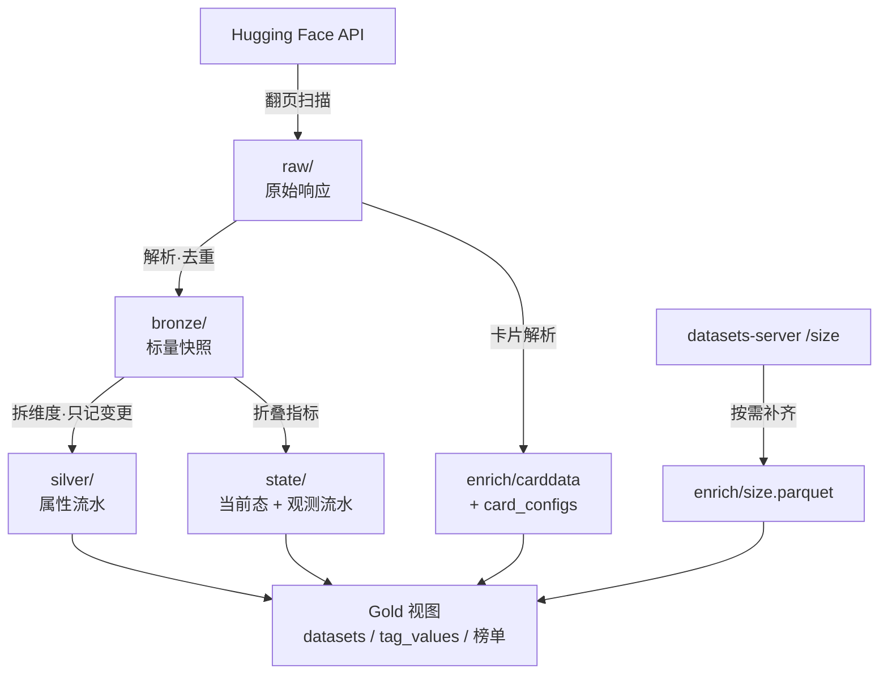

# data 目录说明

> 本文件由 `uv run hf-data-crawl docs` 生成于 2026-11-07 01:15，**请勿手工编辑**。
> 表结构与行数由代码和实际文件算出；字段含义维护在 `src/hf_data_crawl/fielddocs.py`。
> 改完代码后重新生成即可，`tests/test_docs.py` 会在忘记生成时报错。

## 一、数据是怎么流过来的



**Raw 是唯一不可重算的一层**：其余各层删掉都能从它重新推出来，
所以 `build` 可以断网重跑，而 `raw/` 一旦丢失就真的没有了。

## 二、目录一览

```
data/
├── raw/dt=YYYY-MM-DD/          # 原始响应分块，永久保留（当前 3,644 个文件 · 522.5 MB）
├── bronze/dt=YYYY-MM-DD/       # 标量快照，只保留最新一天（当前 1 个文件 · 14.0 MB）
├── silver/dt=YYYY-MM-DD/       # 属性变更流水（当前 3 个文件 · 245.1 MB）
├── state/                      # 当前态与观测流水（当前 4 个文件 · 83.9 MB）
├── enrich/                     # 卡片与规模（当前 3 个文件 · 15.3 MB）
├── meta/                       # 重建中断时留存的状态快照（当前 空）
├── reports/                    # 对账差异清单（当前 3 个文件 · 40.9 MB）
├── runs/                       # 每轮运行摘要（当前 39 个文件 · 19.1 KB）
└── logs/                       # 计划任务日志
```

## 三、各张表

### `bronze/dt={dt}/bronze.parquet`

- 逻辑名：`bronze`
- 来源：由 `raw/` 派生，可随时重建
- 分区：按 `snapshot_date` 分目录，`dt=` 后即日期
- 现状：1 个分区 · 32,344 行 · 14.0 MB

| 字段 | 类型 | 含义 |
| --- | --- | --- |
| `id` | 字符串 | 数据集标识，形如 `作者/名称`，全库唯一 |
| `author` | 字符串 | 拥有者账号（`id` 的前半段） |
| `sha` | 字符串 | 主分支最新提交哈希；仓库内容一变它就变 |
| `created_at` | 字符串 | 仓库创建时刻（ISO 8601，UTC） |
| `last_modified` | 字符串 | 最后一次提交的时刻；增量扫描按它排序 |
| `downloads` | Int64 | **近 30 天**下载量。不是累计值，也不是当日增量 |
| `downloads_all_time` | Int64 | 历史累计下载量，只增不减 |
| `likes` | Int64 | 点赞数 |
| `trending_score` | Float64 | HF 计算的趋势分，可为空；它随时间漂移，**不能用来排序翻页** |
| `gated` | 字符串 | 访问门槛：`false` 公开、`manual` 需人工审批、`auto` 自动授权 |
| `private` | Boolean | 是否私有。私有库对外不可见，但公开索引里可能仍留一条记录 |
| `disabled` | Boolean | 是否被平台禁用 |
| `main_size` | Int64 | 主分支的仓库字节数（含 LFS 指针指向的实际大小） |
| `xet_enabled` | Boolean | 是否使用 Xet 存储后端 |
| `resource_group` | 字符串 | 所属资源组；原值是复合结构，按 JSON 文本存储 |
| `tags` | 字符串数组 | 原始标签全集，形如 `license:mit`、`language:en`；维度列都由它拆出 |
| `description` | 字符串 | 仓库简介（作者填写，非卡片正文） |
| `raw` | 字符串 | 该条记录对应的原始 JSON 整行——其余各层都能重算，只有它能回溯上游 |
| `page_file` | 字符串 | 来源分块文件名，用于把一行追回到具体的 raw 文件 |
| `snapshot_date` | Date | 快照日期，也是分区键——同一条记录落在哪个 `dt=` 目录 |

### `silver/dt={dt}/silver.parquet`

- 逻辑名：`silver`
- 来源：由 `raw/` 派生，可随时重建
- 分区：按 `snapshot_date` 分目录，`dt=` 后即日期
- 现状：3 个分区 · 2,234,640 行 · 245.1 MB

| 字段 | 类型 | 含义 |
| --- | --- | --- |
| `id` | 字符串 | 数据集标识，形如 `作者/名称`，全库唯一 |
| `author` | 字符串 | 拥有者账号（`id` 的前半段） |
| `sha` | 字符串 | 主分支最新提交哈希；仓库内容一变它就变 |
| `created_at` | 字符串 | 仓库创建时刻（ISO 8601，UTC） |
| `last_modified` | 字符串 | 最后一次提交的时刻；增量扫描按它排序 |
| `trending_score` | Float64 | HF 计算的趋势分，可为空；它随时间漂移，**不能用来排序翻页** |
| `gated` | 字符串 | 访问门槛：`false` 公开、`manual` 需人工审批、`auto` 自动授权 |
| `private` | Boolean | 是否私有。私有库对外不可见，但公开索引里可能仍留一条记录 |
| `disabled` | Boolean | 是否被平台禁用 |
| `main_size` | Int64 | 主分支的仓库字节数（含 LFS 指针指向的实际大小） |
| `xet_enabled` | Boolean | 是否使用 Xet 存储后端 |
| `resource_group` | 字符串 | 所属资源组；原值是复合结构，按 JSON 文本存储 |
| `description` | 字符串 | 仓库简介（作者填写，非卡片正文） |
| `tags` | 字符串数组 | 原始标签全集，形如 `license:mit`、`language:en`；维度列都由它拆出 |
| `task_categories` | 字符串数组 | 任务大类（`text-classification`、`image-segmentation` 等） |
| `task_ids` | 字符串数组 | 具体任务标识，比大类更细 |
| `languages` | 字符串数组 | 语言代码（`en`、`zh`、`code` 等） |
| `size_categories` | 字符串数组 | 规模档位（`n<1K`、`1K<n<10K` … `n>1T`） |
| `licenses` | 字符串数组 | 许可证（`mit`、`apache-2.0`、`cc-by-4.0` 等） |
| `libraries` | 字符串数组 | 适配的框架库（`datasets`、`pandas`、`polars` …） |
| `modalities` | 字符串数组 | 模态（`text`、`image`、`audio`、`video`、`3D`） |
| `formats` | 字符串数组 | 数据文件格式（`parquet`、`csv`、`json`、`arrow` …） |
| `regions` | 字符串数组 | 数据覆盖的地区 |
| `multilinguality` | 字符串数组 | 多语言性标记（单语 / 多语） |
| `source_datasets` | 字符串数组 | 该数据集派生自哪些上游数据集 |
| `annotations_creators` | 字符串数组 | 标注者类型（专家、众包、机器生成等） |
| `language_creators` | 字符串数组 | 语料来源（原始采集、翻译、机器生成等） |
| `arxiv_ids` | 字符串数组 | 关联的 arXiv 论文编号 |
| `dois` | 字符串数组 | 关联的 DOI |
| `plain_tags` | 字符串数组 | 不带前缀的标签（旧式 `text`/`image` 标记都在这里） |
| `snapshot_date` | Date | 该行**生效**的日期；同 id 取最新一行即为当前属性 |

### `state/current.parquet`

- 逻辑名：`current`
- 来源：运行态，由派生过程维护
- 分区：单文件，不分区
- 现状：1,117,376 行 · 57.3 MB

| 字段 | 类型 | 含义 |
| --- | --- | --- |
| `id` | 字符串 | 数据集标识，形如 `作者/名称`，全库唯一 |
| `author` | 字符串 | 拥有者账号（`id` 的前半段） |
| `sha` | 字符串 | 主分支最新提交哈希；仓库内容一变它就变 |
| `created_at` | 字符串 | 仓库创建时刻（ISO 8601，UTC） |
| `last_modified` | 字符串 | 最后一次提交的时刻；增量扫描按它排序 |
| `downloads` | Int64 | **近 30 天**下载量。不是累计值，也不是当日增量 |
| `downloads_all_time` | Int64 | 历史累计下载量，只增不减 |
| `likes` | Int64 | 点赞数 |
| `trending_score` | Float64 | HF 计算的趋势分，可为空；它随时间漂移，**不能用来排序翻页** |
| `gated` | 字符串 | 访问门槛：`false` 公开、`manual` 需人工审批、`auto` 自动授权 |
| `private` | Boolean | 是否私有。私有库对外不可见，但公开索引里可能仍留一条记录 |
| `disabled` | Boolean | 是否被平台禁用 |
| `main_size` | Int64 | 主分支的仓库字节数（含 LFS 指针指向的实际大小） |
| `xet_enabled` | Boolean | 是否使用 Xet 存储后端 |
| `resource_group` | 字符串 | 所属资源组；原值是复合结构，按 JSON 文本存储 |
| `first_seen_at` | Date | 首次出现在库里的日期 |
| `last_seen_at` | Date | 最后一次被扫描到的日期；停更不等于下架 |
| `status` | 字符串 | `active` 在架 / `disappeared` 已删除 / `restricted` 转私有 / `renamed` 已改名 |

### `state/observations/dt={dt}/obs.parquet`

- 逻辑名：`observations`
- 来源：运行态，由派生过程维护
- 分区：按 `snapshot_date` 分目录，`dt=` 后即日期
- 现状：3 个分区 · 1,709,128 行 · 26.6 MB

| 字段 | 类型 | 含义 |
| --- | --- | --- |
| `id` | 字符串 | 数据集标识，形如 `作者/名称`，全库唯一 |
| `snapshot_date` | Date | 这次观测发生的日期 |
| `downloads` | Int64 | **近 30 天**下载量。不是累计值，也不是当日增量 |
| `downloads_all_time` | Int64 | 历史累计下载量，只增不减 |
| `likes` | Int64 | 点赞数 |

### `enrich/carddata.parquet`

- 逻辑名：`carddata`
- 来源：由 `raw/` 派生，可随时重建
- 分区：单文件，不分区
- 现状：13,651 行 · 651.4 KB

| 字段 | 类型 | 含义 |
| --- | --- | --- |
| `id` | 字符串 | 数据集标识，形如 `作者/名称`，全库唯一 |
| `snapshot_date` | Date | 快照日期，也是分区键——同一条记录落在哪个 `dt=` 目录 |
| `pretty_name` | 字符串 | 卡片里的展示名（可能与 `作者/名称` 完全不同） |
| `paperswithcode_id` | 字符串 | Papers with Code 上的条目 id |
| `arxiv` | 字符串 | 卡片声明的 arXiv 编号 |
| `license_name` | 字符串 | 卡片声明的许可证名称 |
| `license_link` | 字符串 | 许可证全文链接 |
| `citation` | 字符串 | 作者给出的引用格式（BibTeX 或纯文本） |
| `card_description` | 字符串 | **卡片正文**的开头摘要，与 `description` 字段不是一回事 |
| `card_tags` | 字符串数组 | 卡片 YAML 里声明的标签（作者口径，非平台规范化） |
| `card_task_categories` | 字符串数组 | 卡片声明的任务大类 |
| `card_languages` | 字符串数组 | 卡片声明的语言 |
| `card_size_categories` | 字符串数组 | 卡片声明的规模档 |
| `card_multilinguality` | 字符串 | 卡片声明的多语言性 |
| `card_annotations_creators` | 字符串数组 | 卡片声明的标注者类型 |
| `card_language_creators` | 字符串数组 | 卡片声明的语料来源 |
| `card_source_datasets` | 字符串数组 | 卡片声明的上游数据集 |
| `card_homepage` | 字符串 | 项目主页 |
| `card_config_count` | Int64 | 卡片里列出的 config 个数 |
| `card_num_rows` | Int64 | **作者声明**的总行数（跨 config 累加），未必准 |
| `card_dataset_bytes` | Int64 | 作者声明的数据体积 |
| `card_download_bytes` | Int64 | 作者声明的下载体积（压缩后） |

### `enrich/card_configs.parquet`

- 逻辑名：`card_configs`
- 来源：由 `raw/` 派生，可随时重建
- 分区：单文件，不分区
- 现状：142,552 行 · 2.9 MB

| 字段 | 类型 | 含义 |
| --- | --- | --- |
| `id` | 字符串 | 数据集标识，形如 `作者/名称`，全库唯一 |
| `snapshot_date` | Date | 快照日期，也是分区键——同一条记录落在哪个 `dt=` 目录 |
| `config_name` | 字符串 | 配置名（一个数据集可以有多个 config，如不同语言子集） |
| `split` | 字符串 | 切分名（`train`、`test`、`validation`） |
| `num_bytes` | Int64 | 该 split 的原始字节数 |
| `num_examples` | Int64 | 该 split 的行数 |
| `dataset_size` | Int64 | 生成 arrow 后的内存占用（卡片口径） |
| `download_size` | Int64 | 下载体积（卡片口径） |
| `features` | 字符串 | 列名与数据类型的 JSON 描述——整条管线里唯一能回答「有哪些列」的来源 |
| `data_files` | 字符串 | 该 split 由哪些文件构成（JSON 数组，可能是通配符） |

### `enrich/size.parquet`

- 逻辑名：`size`
- 来源：来自外部接口，**删掉就要重抓**
- 分区：单文件，不分区
- 现状：100,002 行 · 11.8 MB

| 字段 | 类型 | 含义 |
| --- | --- | --- |
| `id` | 字符串 | 数据集标识，形如 `作者/名称`，全库唯一 |
| `snapshot_date` | Date | 最近一次成功补抓的日期 |
| `status` | 字符串 | `ok` 拿到数据 / `unavailable` 上游没有这份数据 / `error` 临时失败 |
| `num_rows` | Int64 | datasets-server **实测**行数，与 `card_num_rows` 是两个口径 |
| `estimated_num_rows` | Int64 | 上游给出的估算行数（未做精确统计时才有） |
| `num_bytes_original` | Int64 | 原始文件字节数 |
| `num_bytes_parquet` | Int64 | 转成 parquet 后的字节数 |
| `num_bytes_memory` | Int64 | 载入内存后的估算占用 |
| `config_count` | Int64 | 上游报告的 config 个数 |
| `num_columns_max` | Int64 | 各 config 中列数的最大值 |
| `configs` | 字符串 | 各 config 的明细（JSON 文本） |

## 四、不属于表的东西

### raw 分块

文件名形如 `<批次>-<页号>-<内容摘要>.json.gz`，摘要由内容算出：
同一页同一内容重写为同一个文件（幂等），内容变了则另存（绝不覆盖丢数据）。
排序依据是 payload 里的 `written_at`，**不是文件名、也不是文件修改时间**。

| 前缀 | 批次 | 派生去向 |
| --- | --- | --- |
| `part-*.json.gz` | 日增量扫描的分块（按 `lastModified` 倒序） | 见上方数据流 |
| `top-*.json.gz` | 顶部池刷新的分块（按 `downloads` 倒序） | 见上方数据流 |
| `card-*.json.gz` | 卡片补齐的分块（带 `cardData`） | 见上方数据流 |

### 其他

| 路径 | 作用 | 生命周期 |
| --- | --- | --- |
| `logs/` | 计划任务的输出日志，按运行日期命名 | 不参与任何派生 |
| `runs/` | 每轮运行摘要，成功与失败都写；`status` 与 `reason` 由命令结局推出 | 只读，供对比两轮退化 |
| `reports/` | 对账差异清单，只保留最近 8 份 | 只读，供人工核对 |
| `ALERT.txt` | 体检发现异常时写入，正常时不存在 | `doctor` 写 |
| `state/reconcile-seen.csv` | 对账会话的已见集合，续跑时靠它避免把前半段误判下架 | 对账完成后删除 |
| `state/*-checkpoint.json` | 扫描游标，记录下一页从哪开始 | 走到末页后清空 |

## 五、几个容易误解的地方

1. **`downloads` 是近 30 天，不是累计**。累计值在 `downloads_all_time`，只增不减。
2. **`card_num_rows` 与 `num_rows` 是两个口径**：前者是作者在卡片里声明的，后者是
   datasets-server 实测的。两个都留着，就是为了让它们能对不上时被看见。
3. **`silver` 是属性流水，不是每日快照**。一个 id 只在属性变化时追加一行，
   所以它的行数会少于 `bronze` 的累计行数；指标历史在 `state/observations`。
4. **`bronze` 只保留最新一天**。历史快照没有保留价值——它可由 `raw` 重算。
5. **`status` 的 `restricted` 不是删除**。它表示数据集转为私有，数据还在，
   只是不再公开。真正删除的 `disappeared` 在全站 111 万条里曾长期为 0。
6. **`main_size` 是仓库字节，不等于数据本身的体积**。仓库含历史版本与 LFS 开销。
